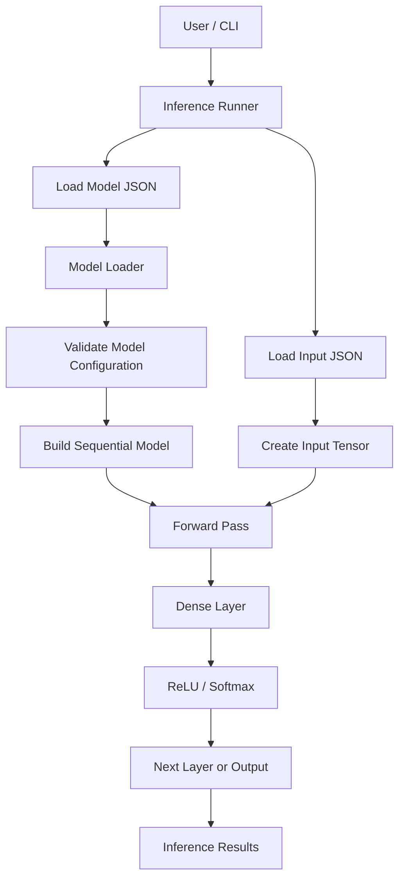

# NIER — System Architecture

NIER (Neural Inference Engine in Rust) is a lightweight neural network inference engine implemented in Rust. It loads a serialized model, validates its configuration, executes supported layers, and returns the inference results.

## 1. High-Level Architecture

## 2. Core Components

### Tensor Engine

The tensor module stores numerical data in a contiguous `Vec<f32>` alongside its shape. It supports shape validation, indexing, element-wise operations, and matrix multiplication.

### Layers

- **Dense:** Computes a linear transformation using weights and bias.
- **ReLU:** Replaces negative values with zero.
- **Softmax:** Converts values into normalized probabilities using a numerically stable implementation.

### Sequential Model

The sequential model executes layers in their configured order. Each layer receives the previous layer's output.

### Model Loader

The loader deserializes the JSON model configuration and validates supported model formats and layer dimensions before inference.

### Inference CLI

The command-line interface loads the model and input, executes the forward pass, and displays the resulting tensor shape and values.

## 3. Dense Layer Computation

For an input matrix \(X\), weight matrix \(W\), and bias vector \(b\):

\[
Y = XW + b
\]

For compatible dimensions:

- \(X\): `[batch_size, input_features]`
- \(W\): `[input_features, output_features]`
- \(b\): `[1, output_features]`
- \(Y\): `[batch_size, output_features]`

The tensor implementation uses row-major storage.

## 4. Inference Flow

1. The user supplies a model JSON file and an input JSON file.
2. The model loader parses and validates the model configuration.
3. The input data is converted into a tensor.
4. The sequential model executes each configured layer.
5. The final tensor is returned and displayed by the CLI.

## 5. Model Format

A model configuration contains a format version and an ordered list of layers. Dense layers specify weights and bias; activation layers specify their type.

See `src/examples/simple.json` for an example model.

## 6. Benchmarking

NIER includes a benchmark mode for measuring inference latency across several fixed network architectures. Measurements are intended to compare implementations on the same machine and under the same conditions.

## 7. Current Scope

NIER currently focuses on CPU-based inference and its supported Dense, ReLU, and Softmax layers. It is a learning and systems-engineering project, not a replacement for mature production inference frameworks.